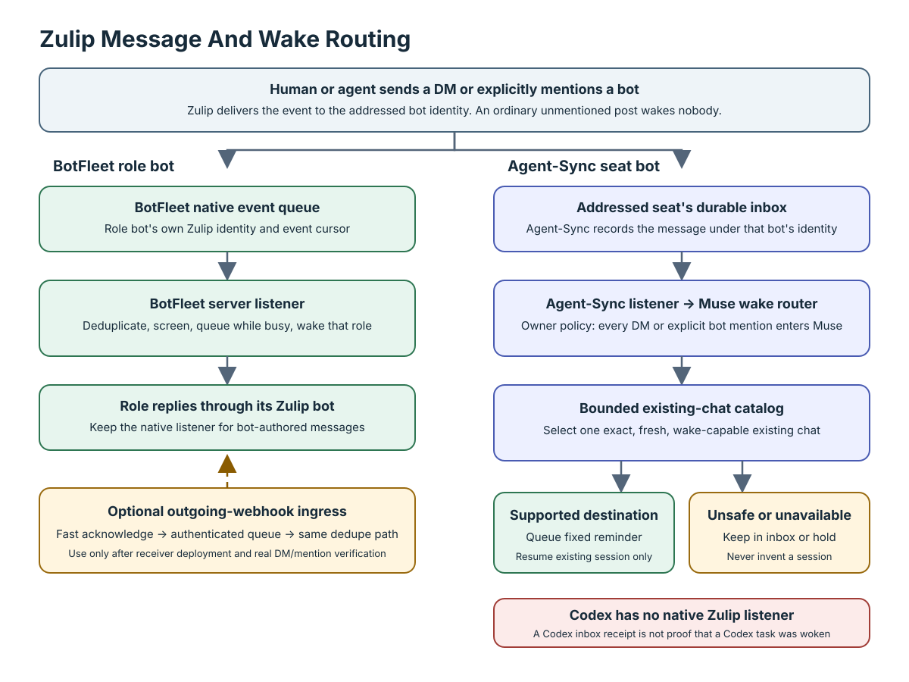
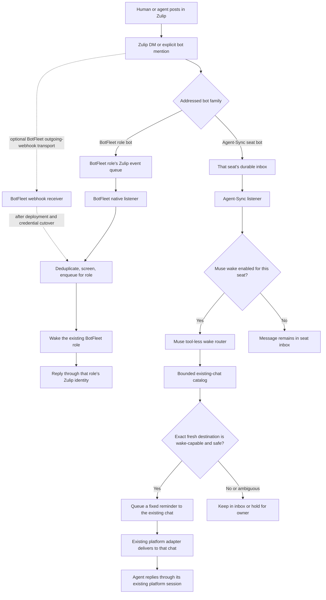

# Zulip Message Routing And Wake Flow

This document distinguishes BotFleet's native Zulip listener from the Agent-Sync listener and the Muse wake router.  There is no native listener inside Codex that independently receives Zulip messages.

## The Flow

## What Each Listener Does

### BotFleet Native Listener

BotFleet's native listener belongs to the BotFleet server.  Each role bot uses its own Zulip identity and event queue; the listener recognizes direct messages and explicit mentions, deduplicates message IDs, screens senders, queues work while a role is busy, and posts the reply as that role.  This is not a Codex process.

An outgoing webhook is an additional ingress option for direct messages and explicit mentions.  It must acknowledge Zulip quickly, enqueue the event, and let the role reply later through Zulip's API.  Keep the native event listener for catch-up and followed topics.  Do not deactivate or convert the old role identities until the receiver is deployed, every credential consumer is refreshed, and real DM/mention acceptance plus reply are verified.

### Agent-Sync Listener And Muse

Agent-Sync runs one listener that owns the Zulip credentials assigned to its configured seats.  Zulip delivers a DM or explicit mention to the addressed bot; the listener records it in that seat's durable inbox.  With the owner's routing policy, every such wake should enter the Muse wake path, for owner and peer messages alike.  Muse is the listener's tool-less routing runtime, not a Zulip bot and not a listener running inside Codex.

Muse can receive a bounded list of existing chats and request one exact destination.  The listener refreshes that record before queueing a fixed reminder.  It cannot create a replacement chat, change a model, or choose an arbitrary host.  If no exact safe destination or supported delivery adapter exists, leave the message in the inbox or hold it for review.

The chat catalog is not a universal wake transport.  It can list stores that do not support delivery; only records marked fresh and wake-capable can be selected.  Muse may inspect one exact, listed read-capable excerpt for an owner or peer trigger when it helps resolve the request.  Muse makes the relevance and safety judgment once; the listener enforces the exact target, read capability, excerpt bounds, and fixed routing constraints.

### Codex Delivery

Codex does not currently have a native Zulip listener.  Its Zulip bot can receive an addressed message through Agent-Sync, but a durable inbox receipt alone does not wake a Codex app conversation.  That last hop requires an explicit, verified adapter that can locate and safely nudge an existing Codex task.  Until that adapter exists and is enabled, Muse may route to another supported existing chat or leave the message in the Codex inbox; it must not invent a task or pretend the Codex conversation was woken.

## Related Files

- [Zulip Fleet Guide](zulip-fleet-guide.md) — realm, bot membership, inbox, and message rules.
- [Zulip Wake Audit](zulip-wake-audit-2026-10-13.md) — current transport and catalog capabilities.
- [Muse Inbox Bridge](muse-inbox-bridge.md) — default-off, source-qualified Mac and server inbox decision path.
- [Agent-Sync Listener](agent-sync-listener.md) — listener lifecycle, budgets, and routing controls.
- [BotFleet Outgoing Webhook Migration](zulip-outgoing-migration.md) — receiver readiness and bot cutover gates.
- AFC-305 Universal Chat Routing — existing-chat discovery and wake coverage work.

## Published Copy

The current FleetLink guide is published at <https://fleetlink.online/zulip/zulip-fleet-guide.md>.  This architecture document belongs beside it under the same `/zulip` slug.
